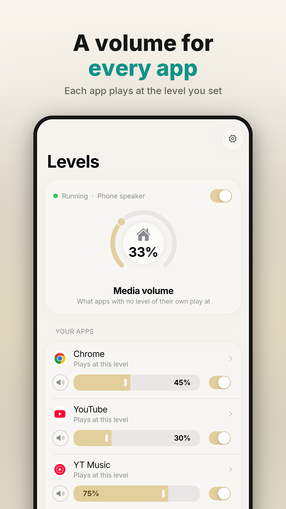
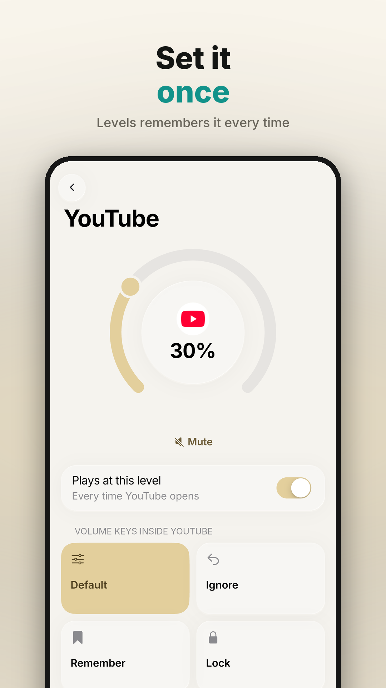
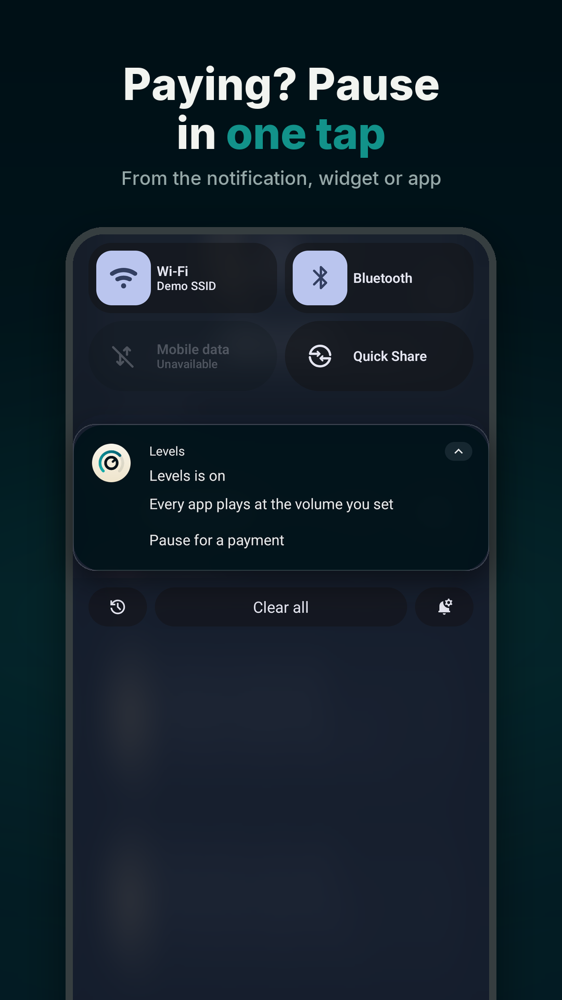
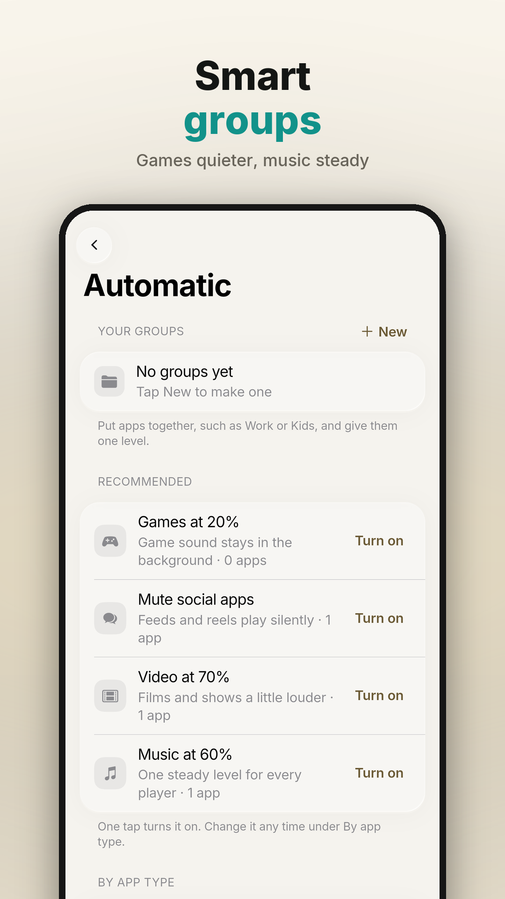
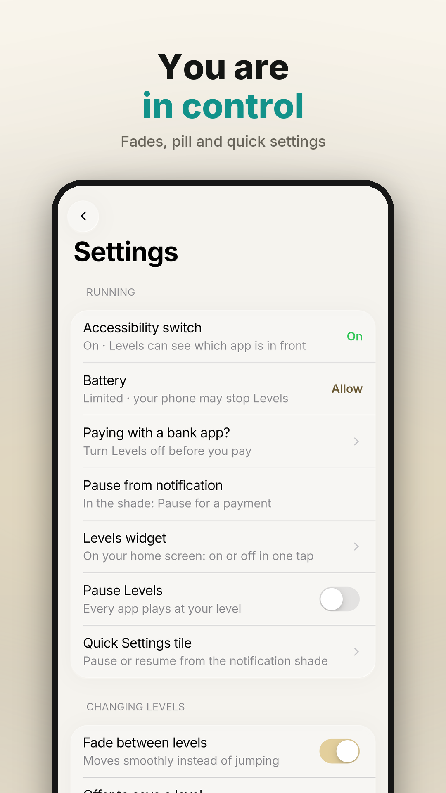
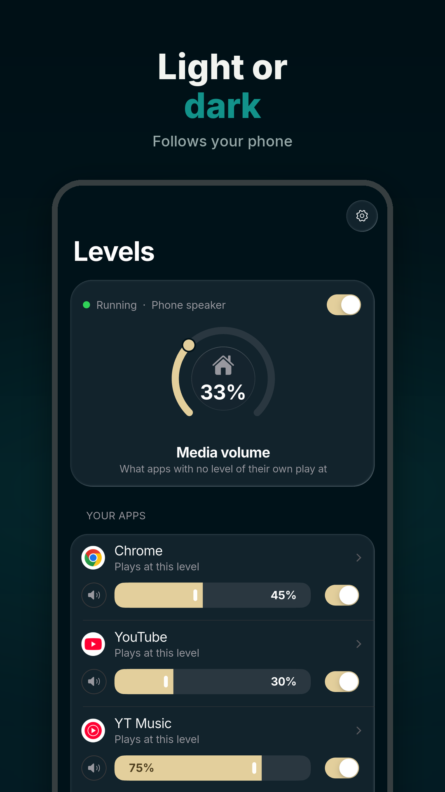
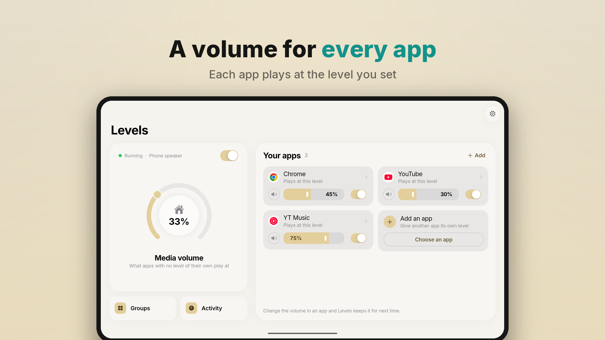
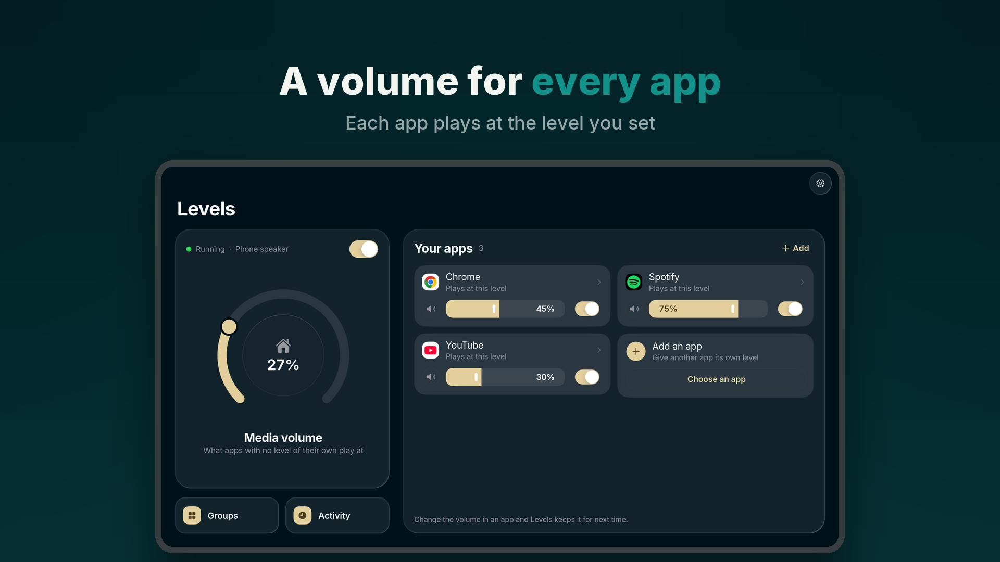

# Levels

A volume for every app on Android. Set YouTube quieter and music louder once, and Levels puts each app back at its own level every time it opens. No ads, no account.

<p>



</p>
<p>



</p>





## Download

Get the latest APK from [Releases](https://github.com/GagandeipSingh/levels/releases/latest). Most phones use the **arm64-v8a** file. Requires Android 7.0 or newer.

## Features

- **A level for every app:** each app plays at the media volume you set for it
- **Volume keys your way:** per app, follow settings, ignore, remember the last change, or lock
- **Rules:** quieter on headphones, softer at night
- **Smart groups:** games quieter, social muted, music steady
- **Pause for a payment:** Google Pay, PhonePe, Paytm and many banks block payments while an accessibility service is on. Pause Levels from its notification, its widget or the app, and turn it back on after you pay
- **Tells you when it stops:** a note if Levels is paused or your phone switches it off, shown again after a restart
- **Light or dark:** follows your phone
- **Any screen:** phones, tablets, foldables and desktop mode

## How it works

Levels uses Android's accessibility service only to know which app is in front, then sets the media volume for it. It does not read your screen, what you type or anything inside apps, and it has no internet access.

## Build

```
flutter pub get
flutter run
```

Release builds read signing details from `android/key.properties`, which is not in this repo. Without it, release builds fall back to the debug key.

## Privacy

Levels collects no data. Your levels stay on your device.
